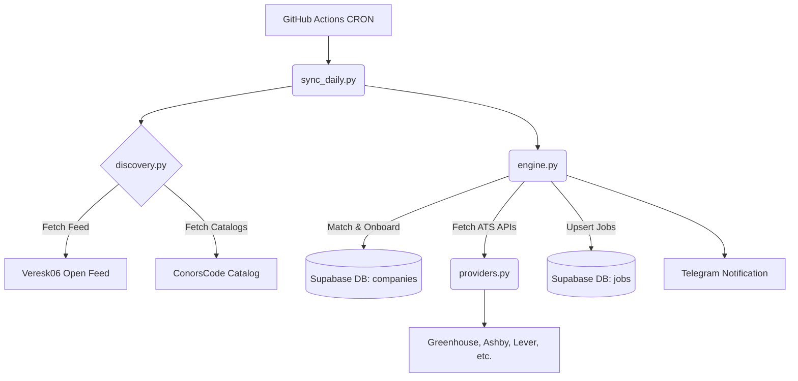

# Startup Jobs Daily Sync Pipeline


An enterprise-grade, highly resilient data pipeline engineered to discover newly funded startups, automatically map their Applicant Tracking System (ATS) endpoints, aggregate active job listings, and perform seamless deduplication into a PostgreSQL data warehouse.

---

## Technical Architecture

* **Language**: Python 3 (Framework-agnostic, low-dependency core for optimal execution speed).
* **Database**: PostgreSQL hosted on Supabase (Utilizing `psycopg` and `JSONB` for robust, schema-flexible data storage).
* **Infrastructure**: GitHub Actions (Automated scheduling via CRON workflows).
* **Telemetry**: Telegram Bot API (Direct HTTP integration for executive summaries and daily reporting).



---

## System Integrations & Data Sources

### 1. Company Discovery Feeds
The system leverages community-maintained datasets to identify high-growth entities (e.g., recent accelerator batches).
* **Primary Feed**: `https://raw.githubusercontent.com/veresk06/open-ats-feed/main/actor/data/companies.json`
* **Entity Catalog**: `https://raw.githubusercontent.com/ConorsCode/open-jobs-data/main/companies.json`

### 2. Supported ATS Adapters (`providers.py`)
The pipeline normalizes native API responses from the following platforms into a unified relational schema:
* Greenhouse (`boards-api.greenhouse.io`)
* Ashby (`api.ashbyhq.com`)
* Lever (`api.lever.co`)
* SmartRecruiters (`api.smartrecruiters.com`)
* Workable (`apply.workable.com`)

---

## Codebase Structure

The architecture follows a strict separation of concerns.

| Component | Responsibility | Description |
| :--- | :--- | :--- |
| **`schema.sql`** | Database Definition | Provisions the PostgreSQL tables (`companies`, `jobs`, `sync_logs`) using cascading safeguards. |
| **`sync_daily.py`** | Orchestration Layer | The production entry point. Initializes environment variables, invokes the processing engine, and dispatches telemetry reports. |
| **`engine.py`** | Core Logic Engine | Implements rate-limiting (daily quotas), state reconciliation, URL deduplication, and transactional database upserts. |
| **`discovery.py`** | Discovery Module | Parses incoming feed payloads, normalizes domains, and executes identity resolution against known ATS catalogs. |
| **`providers.py`** | Adapter Pattern | Contains vendor-specific data transformers. Ensures standardized structural integrity across disparate ATS JSON payloads. |
| **`net.py`** | Network Interface | A resilient HTTP client implementing intelligent backoff, rate-limit handling, and robust JSON deserialization. |
| **`test_engine.py`** | Test Suite | Comprehensive automated tests validating synchronization constraints, transactional integrity, and edge-case API handling. |
| **`requirements.txt`** | Dependencies | Specifies required external libraries (e.g., `psycopg`). |

---

## Standard Operating Procedure: Manual ATS Resolution

Due to the dynamic nature of startup infrastructure, certain companies may fail automated ATS discovery. The telemetry system will flag these events under **Pending Reviews**. Administrators should follow this protocol to resolve discrepancies:

### Step 1: Verification
1. Access the **Supabase Dashboard** -> **Table Editor** -> `companies` table.
2. Filter for records where `ats_status` is marked as `no_ats_found` or `review`.

### Step 2: Discovery
Navigate to the company's official corporate website, locate the "Careers" section, and identify the platform provider via the URL structure.
* *Example:* A URL resolving to `https://jobs.ashbyhq.com/Stripe` indicates the provider is `ashby` and the token is `Stripe`.

### Step 3: Schema Injection
Select the **`ats_sources`** column for the corresponding record. Replace the default empty array `[]` with the following validated JSON structure (modifying the token, provider, and URL accordingly):

```json
[
  {
    "role": "primary",
    "token": "Stripe",
    "status": "verified",
    "provider": "ashby",
    "board_url": "https://jobs.ashbyhq.com/Stripe"
  }
]
```

### Step 4: Status Reconciliation
Update the **`ats_status`** column for the modified row from `no_ats_found` to:
`verified`

**Resolution Complete.** The automated pipeline will seamlessly ingest the authorized endpoint during the subsequent scheduled execution.
